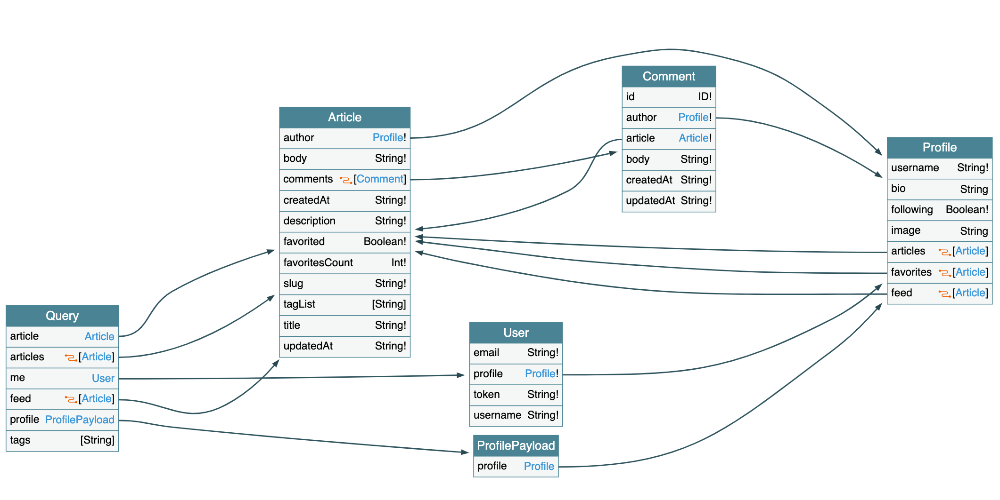

# 

[](https://github.com/gothinkster/spring-boot-realworld-example-app/actions)

> ### Spring boot + MyBatis codebase containing real world examples (CRUD, auth, advanced patterns, etc) that adheres to the [RealWorld](https://github.com/gothinkster/realworld-example-apps) spec and API.

This codebase was created to demonstrate a fully fledged full-stack application built with Spring boot + Mybatis including CRUD operations, authentication, routing, pagination, and more.

For more information on how to this works with other frontends/backends, head over to the [RealWorld](https://github.com/gothinkster/realworld) repo.

# *NEW* GraphQL Support  

Following some DDD principles. REST or GraphQL is just a kind of adapter. And the domain layer will be consistent all the time. So this repository implement GraphQL and REST at the same time.

The GraphQL schema is https://github.com/gothinkster/spring-boot-realworld-example-app/blob/master/src/main/resources/schema/schema.graphqls and the visualization looks like below.



And this implementation is using [dgs-framework](https://github.com/Netflix/dgs-framework) which is a quite new java graphql server framework.
# How it works

The application uses Spring Boot (Web, Mybatis).

* Use the idea of Domain Driven Design to separate the business term and infrastructure term.
* Use MyBatis to implement the [Data Mapper](https://martinfowler.com/eaaCatalog/dataMapper.html) pattern for persistence.
* Use [CQRS](https://martinfowler.com/bliki/CQRS.html) pattern to separate the read model and write model.

And the code is organized as this:

1. `api` is the web layer implemented by Spring MVC
2. `core` is the business model including entities and services
3. `application` is the high-level services for querying the data transfer objects
4. `infrastructure`  contains all the implementation classes as the technique details

# Comments microservice

The codebase has four domain contexts. Comments is the most loosely coupled of them: its only
dependencies on the rest of the system are an `articleId` and a `userId` reference, so it has been
extracted into the standalone [`comments-service`](comments-service/).

| Context | Owns | Lives in |
|---------|------|----------|
| Users / profiles | `users`, `follows` | monolith |
| Articles / tags | `articles`, `tags`, `article_tags` | monolith |
| Favorites | `article_favorites` | monolith |
| Comments | `comments` | `comments-service` (own SQLite database) |

* The monolith still serves the public REST and GraphQL APIs (`/articles/{slug}/comments`, `addComment`, ...).
  It handles authentication, article lookup, and authorization, and enriches comments with author profiles.
* Comment storage goes through `HttpCommentRepository` / `CommentServiceClient`, which call `comments-service` over HTTP
  (`COMMENTS_SERVICE_URL`, default `http://localhost:8081`).
  If the service is unreachable, comment lists come back empty and writes return `503`.
* `comments-service` trusts the `userId` it receives and does no end-user authorization, so it must only be reachable by the monolith:
  every request must carry the shared `X-Service-Token` header (`COMMENTS_SERVICE_TOKEN`, required by both services), and
  Docker Compose does not publish its port to the host.
* `comments-service` API (internal):

| Method | Path | Description |
|--------|------|-------------|
| `POST` | `/articles/{articleId}/comments` | body `{"comment": {"body", "userId", "id"?}}` → `201 {"comment": {...}}` |
| `GET` | `/articles/{articleId}/comments` | `{"comments": [...]}`; optional `limit`, `cursor` (epoch millis), `direction` (`NEXT`/`PREV`) |
| `GET` | `/articles/{articleId}/comments/{id}` | `{"comment": {...}}` or `404` |
| `GET` | `/comments/{id}` | `{"comment": {...}}` or `404` |
| `DELETE` | `/articles/{articleId}/comments/{id}` | `204` or `404` |

Run both services:

```bash
export COMMENTS_SERVICE_TOKEN=$(openssl rand -hex 32)
docker compose up --build
# monolith on http://localhost:8080; comments-service is internal to the compose network
```

Or locally: export the same `COMMENTS_SERVICE_TOKEN` in both shells, run `cd comments-service && ./gradlew bootRun`, then `./gradlew bootRun` in the repository root.

# Security

Integration with Spring Security and add other filter for jwt token process.

The secret key is stored in `application.properties`.

# Database

It uses a ~~H2 in-memory database~~ sqlite database (for easy local test without losing test data after every restart), can be changed easily in the `application.properties` for any other database.

## Sample Data & Login Credentials

The application includes seed data with sample users, articles, tags, comments, and social interactions. You can log in with any of these accounts:

| Username | Email | Password |
|----------|-------|----------|
| johndoe | john@example.com | password123 |
| janedoe | jane@example.com | password123 |
| bobsmith | bob@example.com | password123 |

**Seed data includes:**
- 3 users with profiles
- 5 articles on Spring Boot, REST APIs, Microservices, Docker, and Testing
- 7 tags (java, spring-boot, web-development, tutorial, best-practices, microservices, api-design)
- 5 comments on articles
- 6 article favorites
- 4 follow relationships between users

# Getting started

## Backend (Spring Boot)

You'll need Java 11 installed.

    ./gradlew bootRun

**Note**: `bootRun` automatically cleans and recreates the database with seed data on each run to avoid Flyway migration conflicts during development.

To test that it works, open a browser tab at http://localhost:8080/tags .  
Alternatively, you can run

    curl http://localhost:8080/tags

## Frontend (Next.js)

You'll need Node.js installed. **Recommended: Node v14-16** (specified in `frontend/.nvmrc`).

If using `nvm`, switch to the correct version:
```bash
cd frontend
nvm use
```

Then install and run:
```bash
npm install
npm run dev
```

The frontend will run on http://localhost:3000 and connect to the backend on port 8080.

**Note**: The `npm run dev` script includes `NODE_OPTIONS=--openssl-legacy-provider` for compatibility with newer Node versions, but Node 14-16 is still recommended for best compatibility.

# Try it out with [Docker](https://www.docker.com/)

You'll need Docker installed.
	
    ./gradlew bootBuildImage --imageName spring-boot-realworld-example-app
    docker run -p 8081:8080 spring-boot-realworld-example-app

# Try it out with a RealWorld frontend

The entry point address of the backend API is at http://localhost:8080, **not** http://localhost:8080/api as some of the frontend documentation suggests.

# Run test

The repository contains a lot of test cases to cover both api test and repository test.

    ./gradlew test

# Code format

Use spotless for code format.

    ./gradlew spotlessJavaApply

# Help

Please fork and PR to improve the project.
