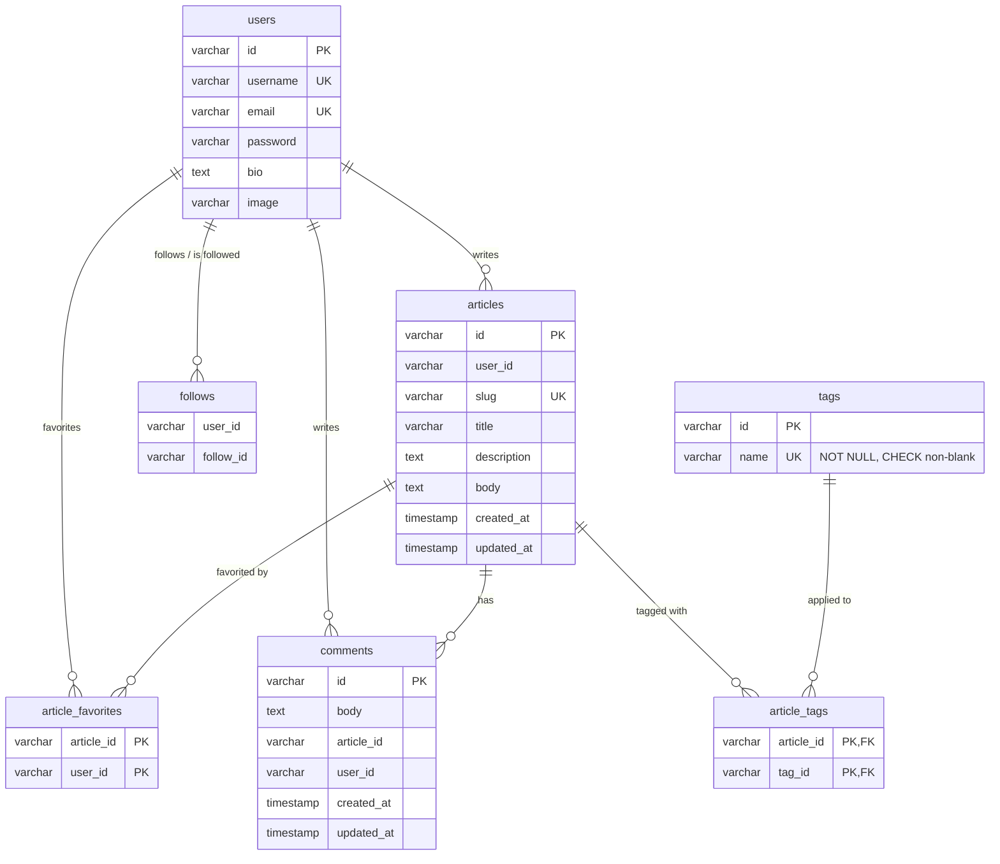

# Schema changes

SQLite, managed by Flyway. Schema migrations live in `src/main/resources/db/migration`. Seed data lives in `src/main/resources/db/seed` and is only applied outside the `test` profile (`spring.flyway.locations`), so tests run every schema migration on an empty database. V2 was moved there unchanged, so its Flyway checksum and existing `dev.db` files still validate.

| Version | Script | Purpose |
|---|---|---|
| V1 | `db/migration/V1__create_tables.sql` | Initial tables |
| V2 | `db/seed/V2__seed_data.sql` | Sample users, articles, tags (dev only) |
| V3 | `db/migration/V3__harden_tag_schema.sql` | Constrain tags and the article/tag junction table |

## ERD (after V3)



## V3 — tag schema hardening

Before (V1) and after (V3) for the two tables V3 changes:

```sql
-- Before (V1)
create table tags (
  id varchar(255) primary key,
  name varchar(255) not null
);
create table article_tags (
  article_id varchar(255) not null,
  tag_id varchar(255) not null
);

-- After (V3)
create table tags (
  id varchar(255) primary key,
  name varchar(255) not null UNIQUE CHECK (length(trim(name)) > 0)
);
create table article_tags (
  article_id varchar(255) not null REFERENCES articles(id) ON DELETE CASCADE,
  tag_id varchar(255) not null REFERENCES tags(id) ON DELETE CASCADE,
  primary key (article_id, tag_id)
);
CREATE INDEX idx_article_tags_tag_id ON article_tags(tag_id);
```

V1 already stored tags in their own `tags` table with an `article_tags` junction table, but without constraints, so duplicate tag names, duplicate links and orphan links were possible. V3:

1. Trims tag names.
2. Merges tags with the same name into the one with the lowest id and re-points their links.
3. Drops blank tags, duplicate links, and links to missing articles or tags. Articles without tags are untouched.
4. Rebuilds `tags` with `UNIQUE(name)` and a non-blank `CHECK`, and `article_tags` with `PRIMARY KEY(article_id, tag_id)` and `ON DELETE CASCADE` foreign keys.
5. Adds `idx_article_tags_tag_id` for lookups by tag (the primary key covers lookups by article).

**Transactions:** Flyway runs each SQLite migration in one transaction, so a failure leaves the V2 schema and data untouched.

**Backward compatibility:** table and column names are unchanged, so code written against V1 keeps reading and writing. Inserting a duplicate tag name or duplicate link now fails instead of silently creating bad data.

**Foreign keys:** SQLite only enforces them with `PRAGMA foreign_keys = ON`, which this app does not set. `MyBatisArticleRepository.remove` and `MyBatisTagRepository.remove` delete `article_tags` rows explicitly, and articles are inserted before their links, so the code is correct with or without enforcement.

**Rollback:** `db/rollback/U3__harden_tag_schema.sql` restores the V1 table shapes and removes the V3 history row. It is outside the Flyway locations (undo migrations need Flyway Teams), so run it manually. Merged tags stay merged and dropped rows are not restored.
